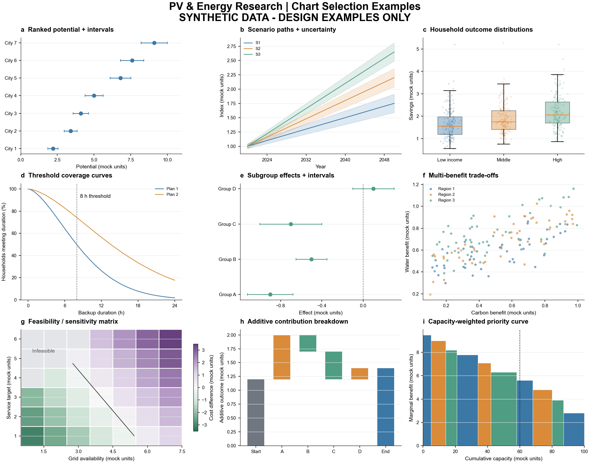

# PV & Energy Figures｜光伏与能源科研作图 Skill

帮助研究者根据科学问题选择图型、组织多面板图、统一颜色语义，并继续完成可复现的绘图代码与视觉检查。

围绕屋顶/立面光伏、气候影响、能源转型、供电可靠性、家庭能源负担和公平性，基于 **20 篇精选参考论文**整理：

- **30 类图型**：适用问题、最低数据需求、编码方式与限制。
- **9 套组图方案**：从空间潜力到部署优先序，从未来情景到家庭分配。
- **10 套建议配色**：分类、顺序、发散配色及中性色，附 HEX 与 Python/R 导出工具。
- **可追溯来源索引**：论文 DOI、图号和 PDF 页码。

This reusable scientific-figure skill supports photovoltaic and energy research with a source-grounded chart atlas, multi-panel layouts, and semantic color palettes. The main documentation is in Chinese; scripts and palette IDs are portable.

## 图型预览

以下为原创模拟数据示例，只演示图型与版式，不代表任何论文的真实结果。



[查看全部配色](skills/pv-energy-figures/assets/palette-preview.svg)

## 下载与安装

- [下载仓库 ZIP](https://github.com/annran-liang/pv-energy-figures/archive/refs/heads/main.zip)
- [下载可直接安装的 Skill ZIP](https://github.com/annran-liang/pv-energy-figures/releases/latest/download/pv-energy-figures.zip)

解压后，将完整的 `pv-energy-figures` 文件夹放入使用工具的 skills 目录。**保留整个文件夹**，包括 `references`、`assets` 和 `scripts`，不能只复制 `SKILL.md`。

例如，已有 Codex 个人 skills 目录时，可以复制到 `~/.codex/skills/pv-energy-figures`。也可将文件保存在项目中，向支持读取本地指令文件的助手明确指定 `skills/pv-energy-figures/SKILL.md`。其他工具的发现机制请遵循各自说明。

仓库结构：

```text
skills/pv-energy-figures/
├── SKILL.md
├── agents/openai.yaml
├── references/          # 图型库、组图、配色、绘制指南与论文索引
├── assets/              # 色库与原创示例预览
└── scripts/             # 配色导出与示例图生成
```

## 使用示例

```text
使用 $pv-energy-figures，我有城市屋顶光伏、减碳、水和土地效益数据。
请比较三种主图组合，说明各面板的作用、所需字段、配色和论文参考。
```

```text
使用 $pv-energy-figures，比较不同收入家庭在未来情景下的能源负担。
推荐比均值柱状图更合适的表达，并区分总体收益和分配公平。
```

```text
使用 $pv-energy-figures，检查这张论文图的颜色语义、面板顺序和不确定性表达，
然后在现有绘图代码中完成修改。
```

通常会给出有实质区别的候选方案，明确推荐项，再提供面板职责、数据条件、颜色编码和来源。用户已经选定图型时直接执行；不强制重新设计。

## 配色工具与依赖

阅读 Skill 与导出配色不需要安装第三方 Python 包。

```bash
python skills/pv-energy-figures/scripts/figure_style.py --palette scenario --format json
python skills/pv-energy-figures/scripts/figure_style.py --palette household-pair --format python
python skills/pv-energy-figures/scripts/figure_style.py --palette change-div --format r
python skills/pv-energy-figures/scripts/figure_style.py --preview palette-preview.svg
```

`--format python` 导出的绘图代码需要 matplotlib；R 代码需要 ggplot2。重新生成模拟图册可使用：

```bash
python -m pip install numpy matplotlib
python skills/pv-energy-figures/scripts/render_gallery.py --out figure-gallery.png
```

## 参考与边界

[论文图谱](skills/pv-energy-figures/references/paper-library.md)记录参考论文与已查看的图页。仓库不包含论文 PDF、原论文图片、私人研究数据或凭据；不依赖作者的本地文件路径。核对原图细节时，应从 DOI 获取合法版本，注意最终出版版与文件页码可能不同。

图型和布局是可迁移的设计经验，配色为重新设计的建议，**不是原论文精确色号、期刊官方标准或色觉无障碍认证**。图中数值来自使用者的数据；示例数据不能当作研究发现。

组织形式参考 [Yuan1z0825/nature-skills 中的 nature-figure](https://github.com/Yuan1z0825/nature-skills/tree/main/skills/nature-figure)。本仓库的领域图谱、组合、色库和脚本独立编写，不包含该仓库代码，也不需要安装它才能使用。

## 贡献

欢迎通过 Issue 或 Pull Request 提供新论文和改进建议。新增图例请注明 DOI、图号、PDF 页码、适用问题与限制；未经视觉核实的来源应标为待核实。请勿上传没有分发授权的论文全文、原图或研究数据。

## 许可

本仓库原创内容与代码采用 [MIT License](LICENSE)。所引用的论文及其他第三方作品保留各自权利，不适用本仓库的许可。
